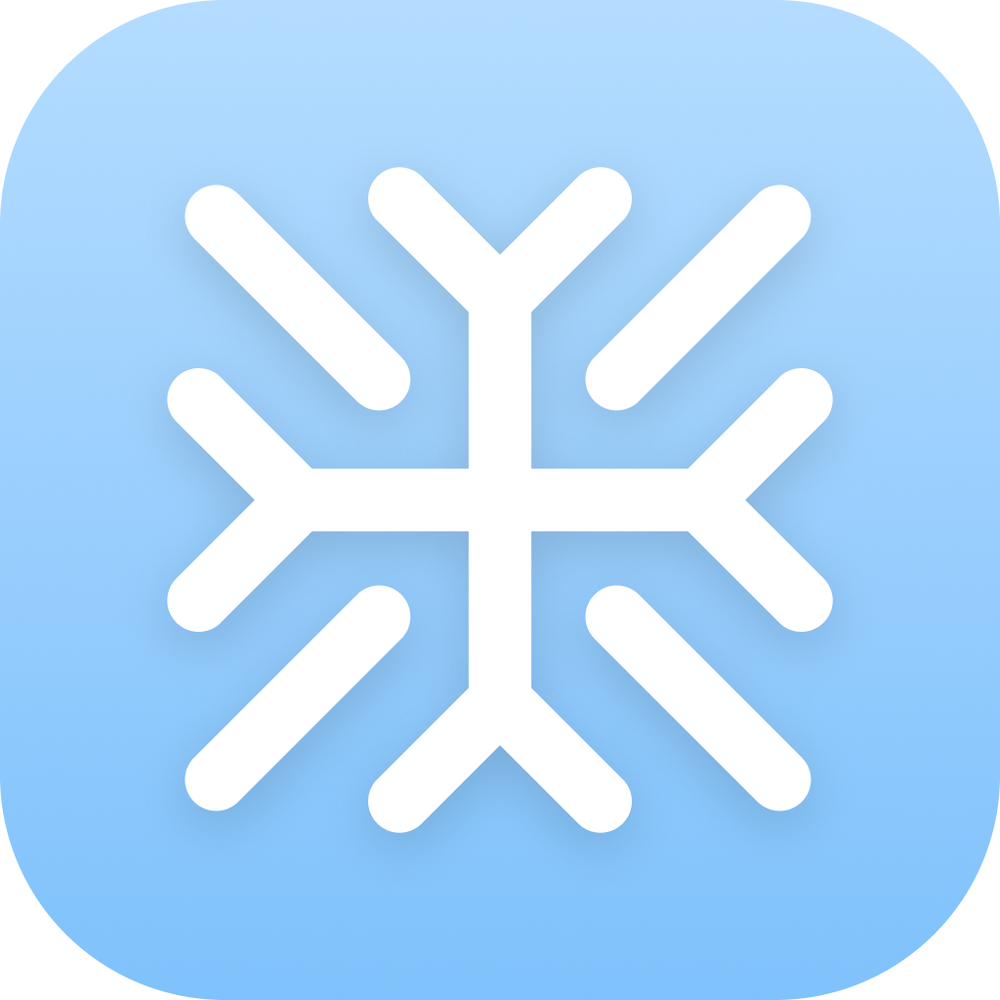
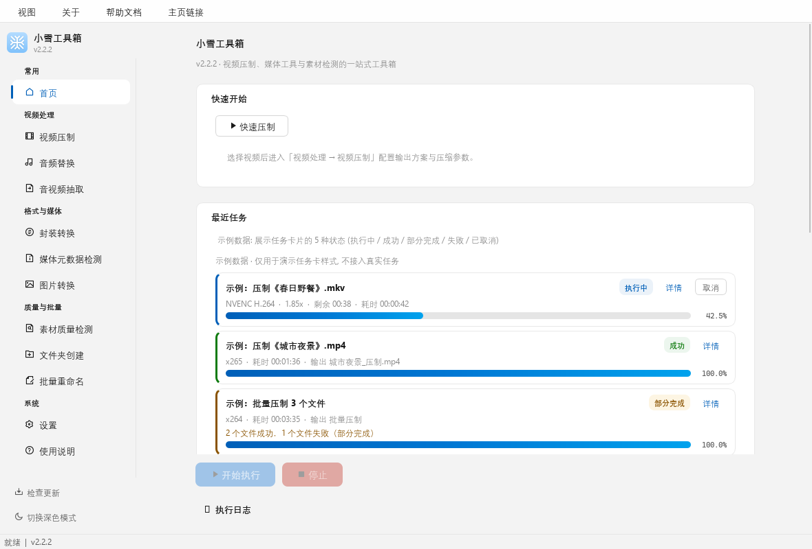
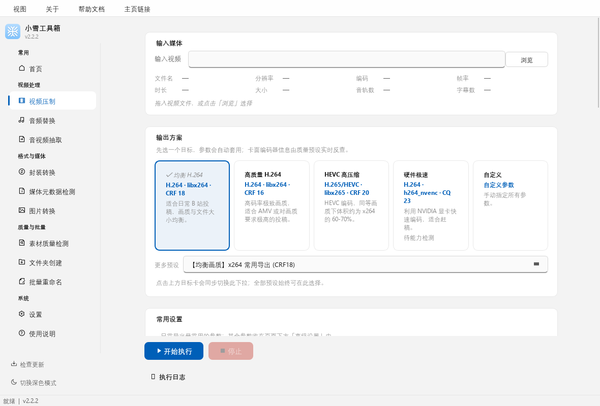
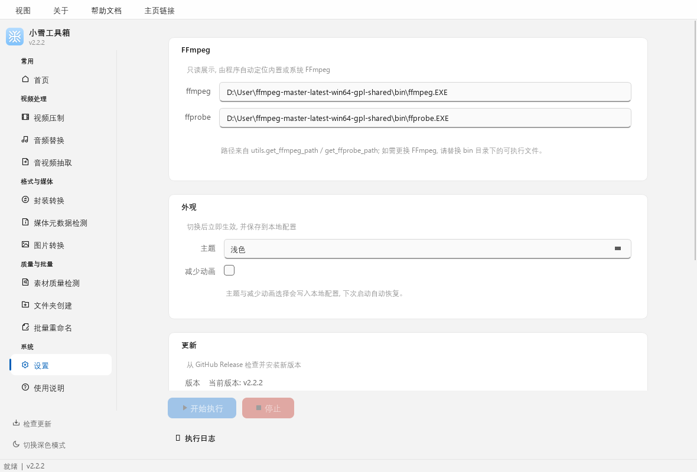
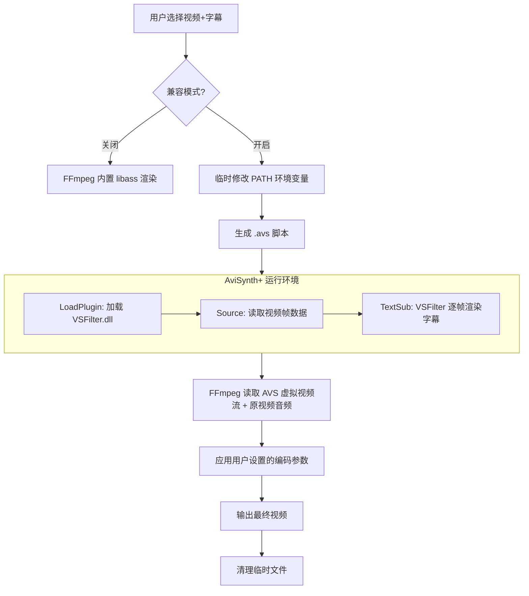

# 小雪工具箱 (XiaoXue Video Toolbox)

<p align="center">
  
</p>

<p align="center">
  
  
  
  
  
  
</p>


<p align="center">
一个简洁实用的视频压制与素材管理工具。基于 Python + PyQt6 图形界面，内置 FFmpeg，开箱即用。
</p>

<p align="center">
  <a href="https://github.com/xueayi/XiaoXue-Video-Tools/wiki">项目首页</a> | 
  <a href="https://github.com/xueayi/XiaoXue-Video-Tools/wiki/Installation">安装部署</a> | 
  <a href="https://github.com/xueayi/XiaoXue-Video-Tools/wiki/%E5%B0%8F%E9%9B%AA%E5%B7%A5%E5%85%B7%E7%AE%B1%E4%BD%BF%E7%94%A8%E6%89%8B%E5%86%8C">使用手册</a> | 
  <a href="https://github.com/xueayi/XiaoXue-Video-Tools/wiki/FAQ">常见问题</a> | 
  <a href="https://github.com/xueayi/XiaoXue-Video-Tools/wiki/Development-Guide">开发指南</a>
</p>


---

## 功能一览





> 界面基于 Windows 11 Fluent Design 风格，支持亮色/暗色双主题，可在「视图」菜单或侧边栏底部切换。

> 一级导航采用分组平铺布局：常用（首页）、视频处理、格式与媒体、质量与批量、系统（设置）；视频压制页按「输入媒体 → 常用设置 → 输出方案 → 高级设置（默认折叠）→ 执行摘要」组织，任务区以任务卡展示进度，失败时显示错误摘要，详细日志默认折叠。任务可随时取消（停止后不会残留 FFmpeg 进程）；进度来自 FFmpeg 结构化协议，失败按错误类别给出原因与建议操作。

### 视频压制

支持 H.264/H.265 编码，内置 5 种输出方案（均衡 H.264 / 高质量 H.264 / HEVC 高压缩 / 硬件极速 / 自定义），可从「更多预设」选择全部预设；可选字幕烧录。

- **编码器**: CPU (libx264/libx265)、NVIDIA NVENC、Intel QSV、AMD AMF；macOS 检测到后提供 Apple VideoToolbox H.264/HEVC
- **码率控制**: CRF/CQ 恒定质量、VBR 可变码率、CBR 恒定码率、真 2-Pass 编码（仅 CPU 编码器）
- **NVENC 档位**: p1(最快) ~ p7(最慢) 可调
- **Debug 模式**: 仅输出 FFmpeg 命令，不实际执行
- **能力检测**: 启动后后台探测 FFmpeg 能力，硬件编码器不可用时自动置灰；硬件编码器使用自身码率控制（NVENC multipass / QSV / AMF），不再伪装 2-Pass

### 预设说明

| 预设        | 编码器     | 质量值 | 速度   | 适用场景    | 音频       |
| ----------- | ---------- | ------ | ------ | ----------- | ---------- |
| 均衡画质    | libx264    | CRF 18 | medium | 日常投稿    | 复制音频流 |
| 极致画质    | libx264    | CRF 16 | slow   | AMV/4K      | 复制音频流 |
| 速度优先    | h264_nvenc | CQ 23  | p4     | NVIDIA 加速 | 复制音频流 |
| 画质优先 HQ | h264_nvenc | CQ 19  | p7     | N 卡高画质  | 复制音频流 |
| 较小体积    | libx264    | CRF 22 | medium | 小体积快速出片 | 复制音频流 |
| HEVC 高压缩 | libx265    | CRF 20 | medium | 高压缩存档  | 复制音频流 |

### 字幕兼容模式

当字幕字体显示异常时，可开启兼容模式：

- **便携设计**: 无需安装 AviSynth，解压即用
- **参数复用**: 所有编码参数与普通模式共用
- **自动清理**: 压制完成后自动删除临时文件
- **所见即所得**: 压制前用aegisub等软件预览字幕效果，与压制后看到的效果一致
- **使用场景**: 可以解决当无法调用TTC/OTF字体的内置字重时造成的字幕错误。
  
本模式需要程序在非中文路径下运行，否则会出错。

> 兼容模式依赖 AviSynth / VSFilter，**仅 Windows 可用**；其它平台会自动隐藏该选项，字幕仍走 FFmpeg 内置 libass 渲染。



### 其他功能

- **封装转换**: MP4/MKV/MOV/TS/WEBM/MXF，不重新编码（转换前预检容器/编码兼容性并给建议）
- **素材质量检测**: 码率/分辨率/兼容性检测，生成报告
- **音频处理**: 音频替换、音频抽取
- **图片转换**: PNG/JPG/WEBP/BMP/GIF/TIFF 互转
- **批量文件管理**: 文件夹批量创建、序列重命名
- **能力检测**: 启动后台检测 FFmpeg 编码器/滤镜/硬件加速与平台能力（AviSynth / 自更新 / VideoToolbox），设置页可查看存储位置并重新检测

---

## 快速开始

### 从发布包运行

在 [Release](https://github.com/xueayi/XiaoXue-Video-Tools/releases) 页面下载：

| 版本                                    | 说明     |
| --------------------------------------- | -------- |
| `XiaoXueToolbox_vX.X.X_Windows_x64.zip` | 标准版   |

> 说明：`Shield`（露骨图片识别）功能与 `Shield 增强版` 已停止发布与维护，后续版本仅提供标准版。

解压后双击 `小雪工具箱.exe` 运行即可。

### 从源代码运行

```bash
# 1. 下载 FFmpeg 并放入 bin/ 目录
# 推荐: https://github.com/BtbN/FFmpeg-Builds/releases

# 2. 安装运行时依赖
pip install -r requirements.txt

# 3. 运行程序
python main.py
```

> 配置、缓存与日志默认保存在程序目录（便携模式）；当目录不可写时自动回退到用户目录（`%APPDATA%` / `%LOCALAPPDATA%`），不会因此启动失败。

### 运行测试

```powershell
# 安装测试依赖 (pytest 在 requirements-dev.txt 中)
pip install -r requirements-dev.txt

# 运行全量测试 (与 CI 一致; CI 已在 main 的 push/PR 上自动执行)
$env:QT_QPA_PLATFORM='offscreen'; python -m pytest -q

# 运行单个文件 / 测试类
python -m pytest tests/test_encode_params.py -v --tb=short
python -m pytest tests/test_encode_params.py::TestNvencPresetOverride -v
```

---

## macOS Apple Silicon Alpha

macOS 原生版沿用现有界面与功能，提供 Apple VideoToolbox H.264/HEVC 和 CPU 编码。
「硬件极速」卡在探测到 Apple 编码器时选择 Apple 预设；Apple 质量值为 0–100，越高画质越好，不能与 x264 CRF 数值直接比较。首版仅提供恒定质量/VBR；AviSynth 兼容模式隐藏，字幕烧录使用 libass；更新为检查版本并打开下载页面。

当前为本地/CI Alpha，尚未提供正式 Release 的 Mac 下载。目标最低系统为 **macOS 13 + Apple Silicon**，目前真机验证在 macOS 27；最低系统仍需实机验收。

### 本地构建

使用最低部署版本不高于 macOS 13 的 **arm64 Python 3.12**；部分 Homebrew Python 只支持安装时的较新系统，构建脚本会检查并拒绝。可使用 Python.org 的兼容发行版，或在项目内用 uv 准备局部运行时：

```bash
uv python install 3.12.12 --install-dir build/python --no-bin
uv venv --python build/python/cpython-3.12.12-macos-aarch64-none/bin/python3.12 build/macos-venv
uv pip install --python build/macos-venv/bin/python -r requirements-build-macos.txt -r requirements-dev.txt
XIAOXUE_BUILD_PYTHON=build/macos-venv/bin/python tools/build_macos.sh
build/macos-venv/bin/python tools/smoke_macos.py
```

产物为 `dist/小雪工具箱.app` 和 `dist/packages/XiaoXueToolbox_v2.3.0-alpha.1_macOS_arm64.zip`，可解压后拖入「应用程序」。应用内置固定 SHA256 校验的 arm64 FFmpeg/ffprobe（包括 libass），无需安装 Homebrew 或配置 PATH。配置、缓存和日志保存在用户 `~/Library` 中。

构建配置见 `XiaoXueToolbox-macOS.spec`，媒体来源及校验和见 `build-resources/macos-media.json`。`Build macOS Alpha` workflow 在 macOS arm64 构建、跑测试并上传 artifact，不自动创建 Release。需要正式签名时可设置 `XIAOXUE_CODESIGN_IDENTITY`；默认包仅做 ad-hoc 签名，尚未完成 Developer ID 公证。

## 许可证

本项目代码采用 **MIT License** 开源。

### 第三方组件声明

| 组件         | 许可证               | 说明                    |
| ------------ | -------------------- | ----------------------- |
| FFmpeg       | LGPL v2.1+ / GPL v2+ | 视频处理核心            |
| AviSynth     | GPL v2+              | 视频处理框架 (兼容模式) |
| LSMASHSource | ISC License          | 视频解码插件            |
| VSFilter     | GPL v2+              | 字幕渲染插件            |
| PyQt6        | GPL v3 / Commercial  | Python GUI 框架         |

**注意**: 兼容模式使用的 AviSynth、LSMASHSource、VSFilter 均为开源组件。相关源代码可从各自的官方仓库获取。
